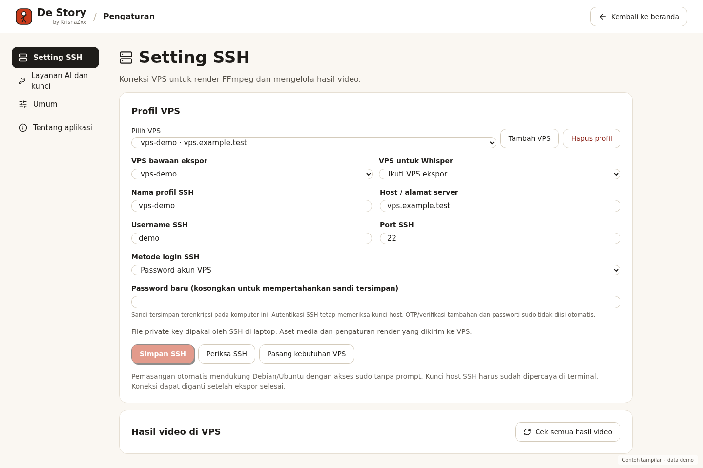

# De Story

**by KrisnaZxx** — buat video cerita dari ide, naskah, gambar, suara, caption, sampai MP4.

## Unduh aplikasi

**[⬇ Unduh untuk Windows](https://github.com/KrisnaZxx/De-Story/releases/download/v1.2.1/De.Story_1.2.1_x64-setup.exe)** · **[Semua rilis](https://github.com/KrisnaZxx/De-Story/releases)**

**v1.2.1 · rilis uji publik. Unduh satu installer sesuai perangkatmu.**

| Perangkat | File yang dipilih | Ukuran |
| --- | --- | --- |
| Windows x64 | **[Installer .exe](https://github.com/KrisnaZxx/De-Story/releases/download/v1.2.1/De.Story_1.2.1_x64-setup.exe)** | ±311 MB |
| Ubuntu / Debian desktop x64 | **[Paket .deb](https://github.com/KrisnaZxx/De-Story/releases/download/v1.2.1/De.Story_1.2.1_amd64.deb)** | ±549 MB |
| macOS Apple Silicon (M1/M2/M3 dan seterusnya) | **[Installer .dmg](https://github.com/KrisnaZxx/De-Story/releases/download/v1.2.1/De.Story_1.2.1_aarch64.dmg)** | ±510 MB |

Alternatif: [Windows .msi](https://github.com/KrisnaZxx/De-Story/releases/download/v1.2.1/De.Story_1.2.1_x64_en-US.msi) · [Linux .AppImage](https://github.com/KrisnaZxx/De-Story/releases/download/v1.2.1/De.Story_1.2.1_amd64.AppImage) · [Checksum SHA-256](https://github.com/KrisnaZxx/De-Story/releases/download/v1.2.1/SHA256SUMS).

File **Source code** untuk pengembang. Pengguna biasa cukup memakai installer di atas. Paket macOS Intel dan Linux ARM belum tersedia. Build Linux/macOS sudah berhasil; penggunaan GUI-nya belum diuji langsung.

## Instalasi

- **Windows:** jalankan `.exe`, ikuti installer, lalu buka De Story. Jika diminta, pasang WebView2 Runtime.
- **Ubuntu 22.04+ / Debian 12+ dengan desktop:** buka `.deb` melalui pengelola paket dan instal dependensinya. Keyring desktop harus aktif. Untuk AppImage, aktifkan izin executable melalui Properties; dependensi sistem tetap diperlukan.
- **macOS Apple Silicon:** buka `.dmg`, pindahkan De Story ke Applications. FFmpeg harus tersedia di `PATH`; paket saat ini belum membundelkannya. Keychain dipakai untuk menyimpan kunci layanan.

Chrome/Chromium reguler diperlukan jika memakai login Google Flow. Akun dan API key layanan AI disiapkan sendiri.

## Mulai membuat video

1. Buka **Pengaturan → Layanan AI dan kunci**. Siapkan layanan naskah, suara TTS, serta gambar/video yang ingin dipakai.
2. Klik **Proyek baru**. Isi ide, pilih durasi, rasio 16:9/9:16, gaya, suara, dan **Model AI**.
3. Klik **Susun naskah**, periksa adegan, lalu lanjut ke **Storyboard** untuk membuat gambar dan narasi. Video AI opsional; gerak kamera juga tersedia.
4. Buka **Editor** untuk mengatur caption, durasi klip, transisi, musik, dan preview layar penuh.
5. Klik **Ekspor video**, pilih lokal/VPS dan resolusi/FPS. Setelah mulai, dialog menutup; pantau lewat **Riwayat ekspor**.

Untuk YouTube 16:9, tombol **Thumbnail** dan **Deskripsi & tag** ada di Editor. Hasilnya terpisah dari MP4. Simpan otomatis aktif; **Ctrl+S** menyimpan langsung. Biarkan komputer aktif selama proses—mode sleep dapat menghentikan pekerjaan.

### Tambah akun Google Flow

1. **Pengaturan → Layanan AI dan kunci → Google Flow**. Tunggu Flow2API internal siap.
2. Pada **Sesi login Flow**, klik **Tambah profil akun → Buka profil / login**.
3. Login manual sampai halaman Google Flow terbuka. **Tutup jendela profil Chrome melalui X.**
4. Kembali ke De Story, klik **Selesai login dan simpan**, lalu tunggu **Sesi siap**.

Ulangi untuk akun lain. Pada pengaturan multiakun, pilih jumlah akun atau **Semua akun tersambung**. Aktifkan **Perbarui sesi otomatis** jika diperlukan. Google tetap dapat meminta verifikasi/login ulang.

### Whisper dipakai untuk apa?

Gemini TTS membuat suara. Whisper menentukan waktu kata untuk menyinkronkan caption dan membantu pembagian audio per adegan.

Program Whisper ikut installer, tetapi **model Small ±488 MB diunduh sekali** melalui **Layanan AI dan kunci → Caption Whisper → Unduh model** untuk pemakaian lokal. Bisa juga dijalankan di VPS. Jika dimatikan, aplikasi memakai perkiraan timing. [Panduan caption dan audio](docs/PANDUAN.md#caption-klip-dan-editor).

## Fitur

- Durasi hingga 30 menit; format YouTube 16:9 dan Shorts 9:16.
- Naskah Gemini/OpenRouter/Groq/custom; suara Gemini/ElevenLabs.
- Gambar/video Flow, Higgsfield API/MCP, dan Vidgen; multiakun Flow/Vidgen.
- Caption yang bisa diedit/digeser, undo/redo, zoom dan geser timeline, serta preview fullscreen.
- Thumbnail, deskripsi, dan tag otomatis untuk proyek 16:9.
- Ekspor FFmpeg lokal/VPS, beberapa profil SSH dengan key/password, riwayat ekspor, unduh/hapus hasil VPS, dan informasi storage.

Biaya/kuota mengikuti layanan yang dipilih. **Gambar Vidgen memakai kredit berbayar**; paket Unlimited video tidak otomatis berlaku untuk gambar. Trial/MCP dan akses model mengikuti hak akun penyedia.

## Memperbarui aplikasi

1. Tunggu pekerjaan selesai, tutup De Story, lalu cadangkan folder data.
2. Unduh satu installer versi baru untuk OS yang sama dari **[Releases](https://github.com/KrisnaZxx/De-Story/releases)**.
3. Jalankan installer Windows/paket `.deb`, ganti aplikasi di Applications untuk macOS, atau gunakan AppImage baru. Pertahankan folder data aplikasi.
4. Buka De Story dan periksa versi di **Pengaturan → Tentang aplikasi**.

| OS | Folder data untuk backup |
| --- | --- |
| Windows | `%APPDATA%\De Story` |
| Linux | `$XDG_DATA_HOME/De Story`, biasanya `~/.local/share/De Story` |
| macOS | `~/Library/Application Support/De Story` |

Backup seluruh folder, bukan hanya `studio.db`, agar media ikut tersimpan. Jangan membagikan backup karena memuat data akun. Pindah komputer/OS dapat memerlukan pengisian key atau login ulang.

## Bantuan dan panduan

| Kebutuhan | Panduan |
| --- | --- |
| Akun/model, multiakun, extension worker, Higgsfield, Vidgen | [Layanan AI](docs/PANDUAN.md#pengaturan-layanan-ai) |
| Caption terlambat, klip terlalu pendek, undo, timeline | [Caption dan editor](docs/PANDUAN.md#caption-klip-dan-editor) |
| Whisper VPS, ekspor SSH, unduh/hapus hasil | [Ekspor dan VPS](docs/PANDUAN.md#ekspor-lokal-dan-vps) |
| Login ditolak, timeout, SSH gagal, render lambat | [Masalah umum](docs/PANDUAN.md#masalah-umum) |
| Build source dan membuat rilis | [Panduan pengembang](docs/PENGEMBANGAN.md) |
| Melaporkan bug | [Buat issue](https://github.com/KrisnaZxx/De-Story/issues/new) |

Saat melaporkan bug, sertakan versi aplikasi, OS, langkah kejadian, dan pesan error. Sensor API key, password, cookie, serta informasi pribadi pada log/screenshot.

## Cuplikan aplikasi

Contoh tampilan memakai data demo.

Lihat sesi Flow, riwayat ekspor, dan pengaturan SSH

## Kredit dan lisensi komponen

Pengembangan **KrisnaZxx**. Lisensi komponen tetap disertakan: [font dan ikon](resources/licenses), [Whisper](resources/licenses/whisper.cpp-LICENSE.txt), serta [Flow2API](flow2api-src/LICENSE). Lisensi FFmpeg ikut paket Windows. [Catatan source dan publikasi](docs/PENGEMBANGAN.md#menyiapkan-github-dan-kredit).
