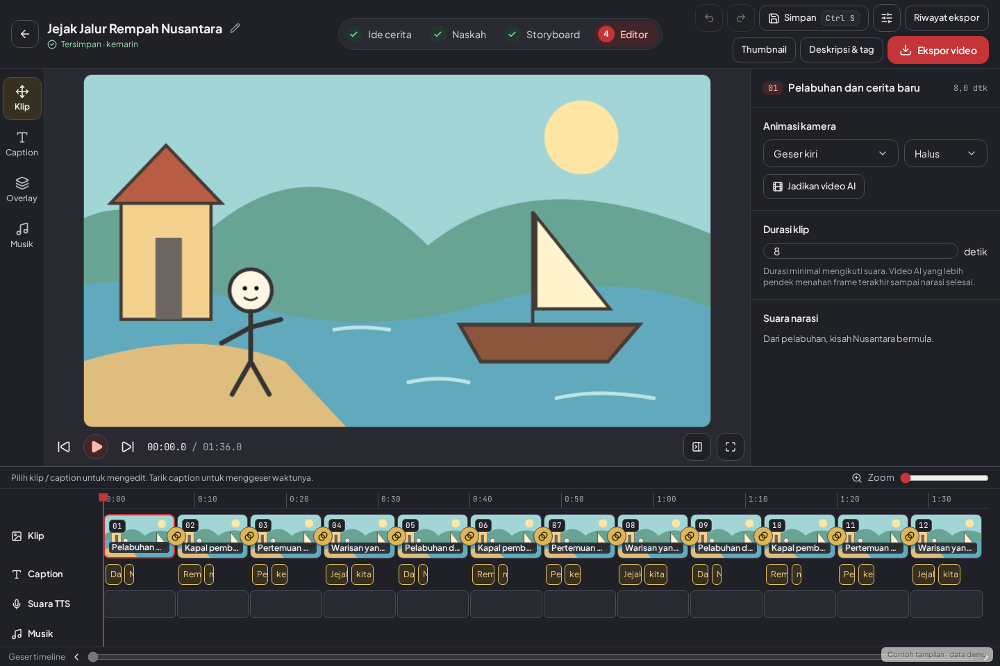
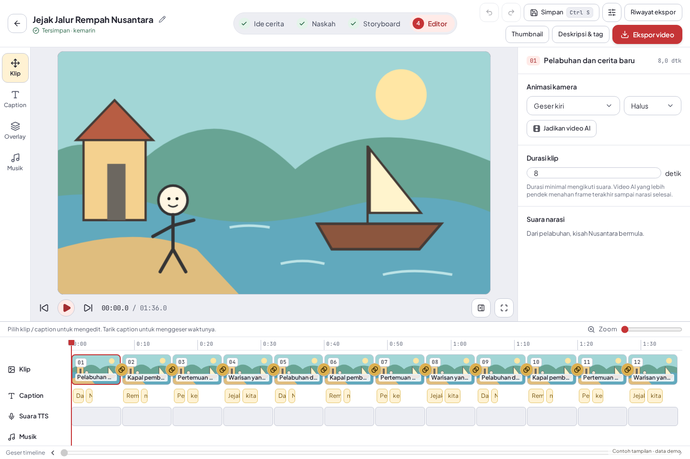
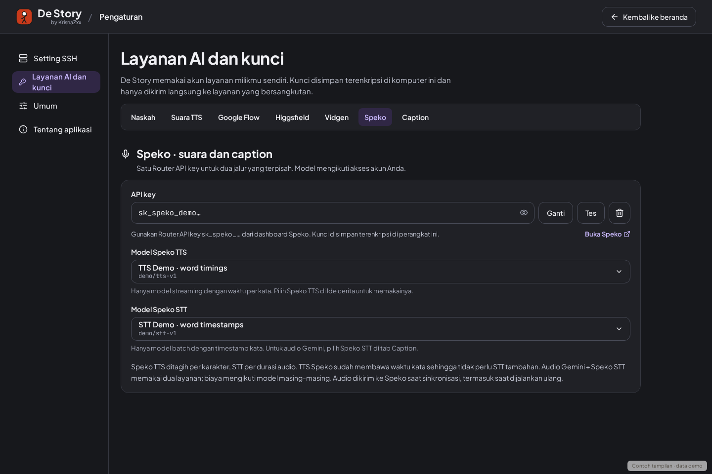
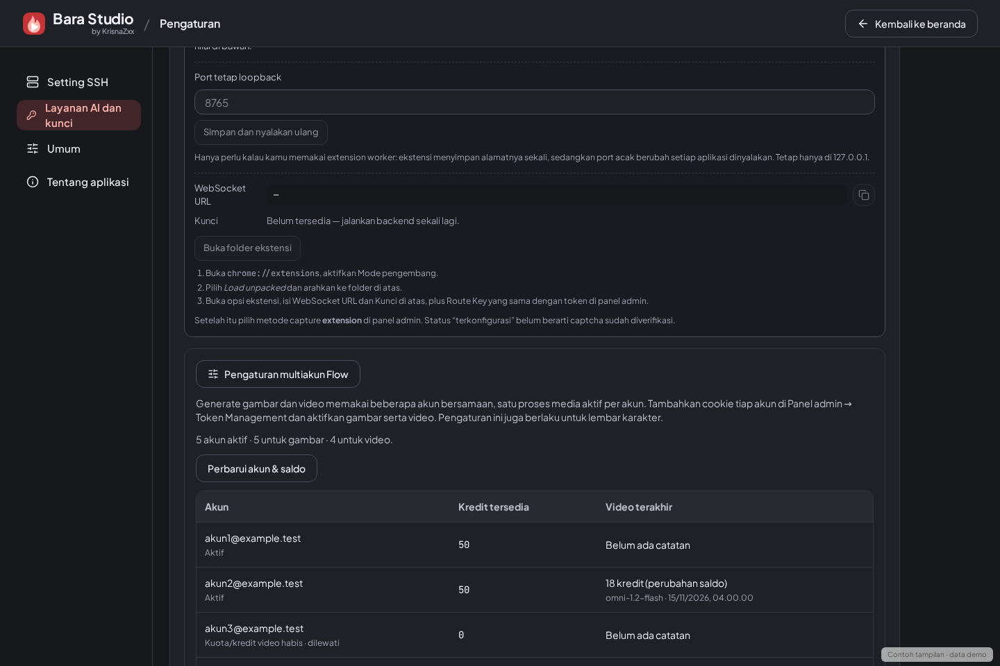
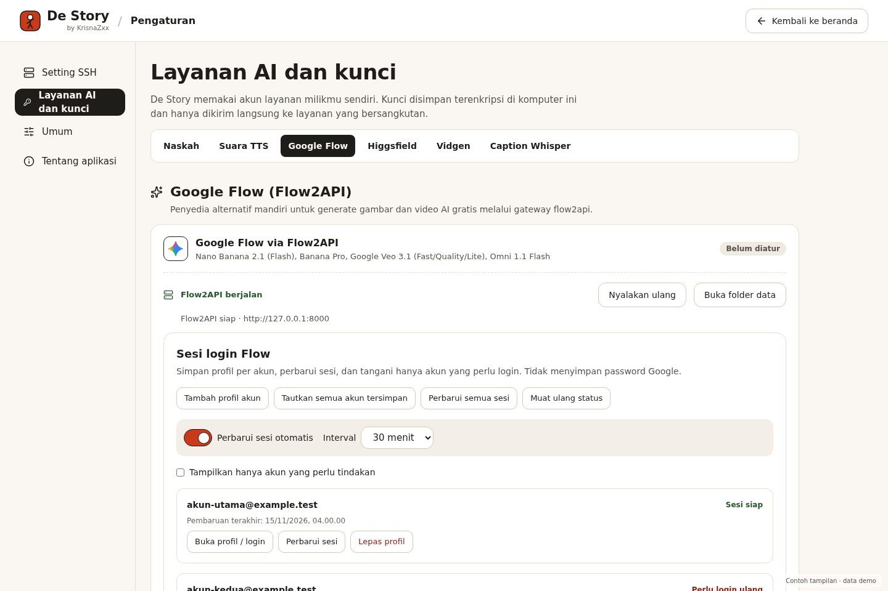
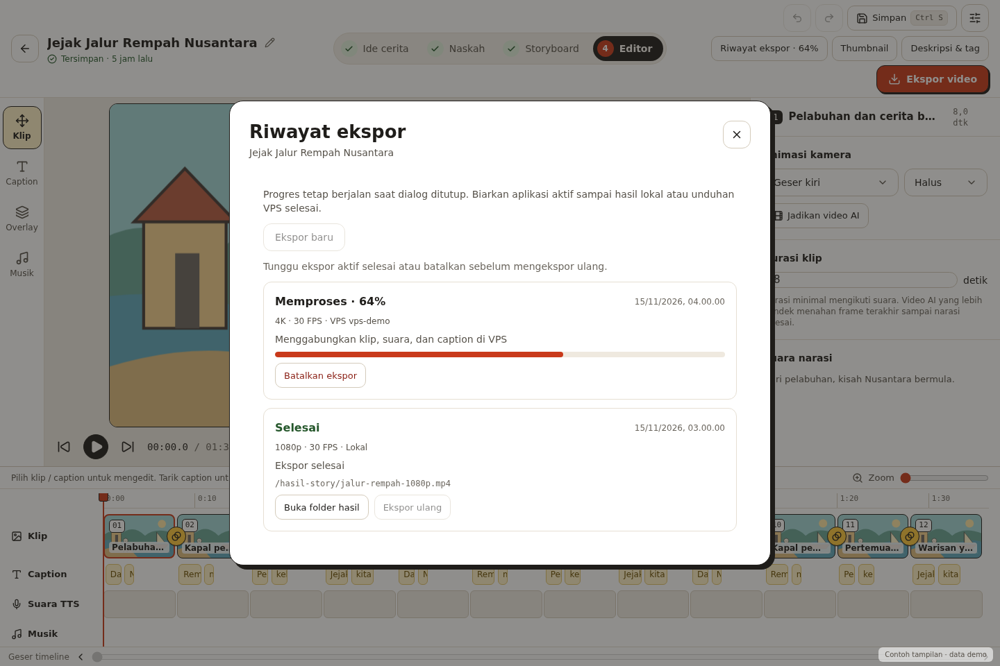

# Bara Studio

Sebelumnya bernama De Story. Data proyek dan sesi tetap memakai folder data lama.

**by KrisnaZxx** — buat video cerita dari ide, naskah, gambar, suara, caption, sampai MP4.

## Unduh aplikasi

**[Unduh Bara Studio untuk Windows x64](https://github.com/KrisnaZxx/De-Story/releases/latest)**

Pilih installer `.exe` atau `.msi` dari bagian **Assets**. Bara Studio dirilis khusus Windows x64.

## Instalasi

Jalankan installer, ikuti langkah pemasangan, lalu buka Bara Studio. Jika diminta, pasang WebView2 Runtime.

Chrome/Chromium reguler diperlukan jika memakai login Google Flow. Akun dan API key layanan AI disiapkan sendiri.

## Mulai membuat video

1. Buka **Pengaturan → Layanan AI dan kunci**. Siapkan layanan naskah, suara TTS, serta gambar/video yang ingin dipakai.
2. Klik **Proyek baru**. Isi ide, pilih durasi, rasio 16:9/9:16, gaya, suara, dan **Model AI**.
3. Klik **Susun naskah**, periksa adegan, lalu lanjut ke **Storyboard** untuk membuat gambar dan narasi. Video AI opsional; gerak kamera juga tersedia.
4. Buka **Editor** untuk mengatur caption, durasi klip, transisi, musik, dan preview layar penuh.
5. Klik **Ekspor video**, pilih lokal/VPS dan resolusi/FPS. Setelah mulai, dialog menutup; pantau lewat **Riwayat ekspor**.

Untuk YouTube 16:9, tombol **Thumbnail** dan **Deskripsi & tag** ada di Editor. Hasilnya terpisah dari MP4. Simpan otomatis aktif; **Ctrl+S** menyimpan langsung. Biarkan komputer aktif selama proses—mode sleep dapat menghentikan pekerjaan.

### Tambah akun Google Flow

1. **Pengaturan → Layanan AI dan kunci → Google Flow**. Tunggu Flow2API internal siap.
2. Pada **Sesi login Flow**, klik **Tambah profil akun → Buka profil / login**.
3. Login manual sampai halaman Google Flow terbuka. **Tutup jendela profil Chrome melalui X.**
4. Kembali ke Bara Studio, klik **Selesai login dan simpan**, lalu tunggu **Sesi siap**.

Ulangi untuk akun lain. Pada pengaturan multiakun, pilih jumlah akun atau **Semua akun tersambung**. Aktifkan **Perbarui sesi otomatis** jika diperlukan. Google tetap dapat meminta verifikasi/login ulang.

### Whisper dipakai untuk apa?

Gemini TTS membuat suara. Whisper menentukan waktu kata untuk menyinkronkan caption dan membantu pembagian audio per adegan.

Program Whisper ikut installer, tetapi **model Small ±488 MB diunduh sekali** melalui **Layanan AI dan kunci → Caption → Unduh model** untuk pemakaian lokal. Bisa juga dijalankan di VPS. Jika dimatikan, aplikasi memakai perkiraan timing. [Panduan caption dan audio](docs/PANDUAN.md#caption-klip-dan-editor).

### Speko untuk suara / caption

1. **Layanan AI dan kunci → Speko:** isi Router API key, lalu pilih model TTS dan/atau STT dari katalog akun.
2. **Gemini + Speko STT:** tetap pilih Gemini TTS di proyek; pada tab **Caption**, pilih **Speko STT** dan aktifkan **Sinkronkan otomatis**.
3. **Speko TTS:** pilih Speko TTS di langkah **Ide cerita**. Waktu kata ikut hasil suara, tanpa Whisper atau STT tambahan.

STT Speko memakai durasi audio, TTS memakai karakter. Sinkronisasi ulang memakai biaya STT lagi. [Pengaturan dan batas Speko](docs/PANDUAN.md#speko-tts-dan-stt).

## Fitur

- Tema gelap Graphite dan terang Pearl, langsung diganti melalui **Pengaturan → Umum**.
- Durasi hingga 30 menit; format YouTube 16:9 dan Shorts 9:16.
- Naskah Gemini/OpenRouter/Groq/custom; suara Gemini/ElevenLabs/Speko, serta Gemini + Speko STT.
- Gambar/video Flow, Higgsfield API/MCP, dan Vidgen; multiakun Flow/Vidgen.
- Caption yang bisa diedit/digeser, undo/redo, zoom dan geser timeline, serta preview fullscreen.
- Thumbnail, deskripsi, dan tag otomatis untuk proyek 16:9.
- Ekspor FFmpeg lokal/VPS hingga 4K, termasuk **2K (1440p)**, pembagian render klip ke beberapa VPS dengan transfer privat InstaBox, profil SSH dengan key/password, riwayat ekspor, unduh/hapus hasil VPS, dan informasi storage.

Biaya/kuota mengikuti layanan yang dipilih. **Gambar Vidgen memakai kredit berbayar**; paket Unlimited video tidak otomatis berlaku untuk gambar. Trial/MCP dan akses model mengikuti hak akun penyedia.

## Memperbarui aplikasi

1. Tunggu pekerjaan selesai, tutup Bara Studio, lalu cadangkan folder data.
2. Unduh installer Windows x64 versi baru dari **[Releases](https://github.com/KrisnaZxx/De-Story/releases)**.
3. Jalankan installer Windows baru. Pertahankan folder data aplikasi.
4. Buka Bara Studio dan periksa versi di **Pengaturan → Tentang aplikasi**.

Folder data Windows ada di `%APPDATA%\De Story`.

Backup seluruh folder, bukan hanya `studio.db`, agar media ikut tersimpan. Jangan membagikan backup karena memuat data akun. Pindah komputer dapat memerlukan pengisian key atau login ulang.

## Bantuan dan panduan

| Kebutuhan | Panduan |
| --- | --- |
| Akun/model, multiakun, extension worker, Higgsfield, Vidgen | [Layanan AI](docs/PANDUAN.md#pengaturan-layanan-ai) |
| Caption terlambat, klip terlalu pendek, undo, timeline | [Caption dan editor](docs/PANDUAN.md#caption-klip-dan-editor) |
| Whisper VPS, ekspor SSH, unduh/hapus hasil | [Ekspor dan VPS](docs/PANDUAN.md#ekspor-lokal-dan-vps) |
| Login ditolak, timeout, SSH gagal, render lambat | [Masalah umum](docs/PANDUAN.md#masalah-umum) |
| Build source dan membuat rilis | [Panduan pengembang](docs/PENGEMBANGAN.md) |
| Melaporkan bug | [Buat issue](https://github.com/KrisnaZxx/De-Story/issues/new) |

Saat melaporkan bug, sertakan versi aplikasi, OS, langkah kejadian, dan pesan error. Sensor API key, password, cookie, serta informasi pribadi pada log/screenshot.

## Cuplikan aplikasi

Contoh tampilan memakai data demo. Tampilan merah Bara Studio v1.4.0 di bawah masih dalam pengujian lokal; beberapa gambar pengaturan memperlihatkan rilis sebelumnya.

Lihat tema terang, Speko, sesi Flow, riwayat ekspor, dan SSH

## Kredit dan lisensi komponen

Pengembangan **KrisnaZxx**. Lisensi komponen tetap disertakan: [font dan ikon](resources/licenses), [Whisper](resources/licenses/whisper.cpp-LICENSE.txt), serta [Flow2API](flow2api-src/LICENSE). Lisensi FFmpeg ikut paket Windows. [Catatan source dan publikasi](docs/PENGEMBANGAN.md#menyiapkan-github-dan-kredit).
